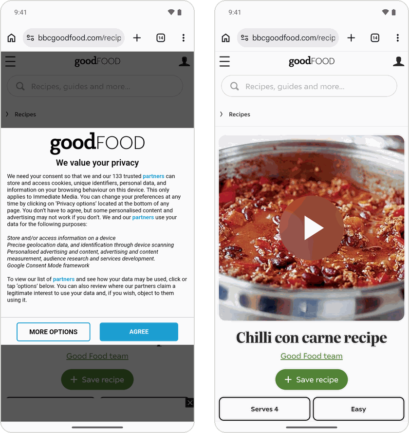
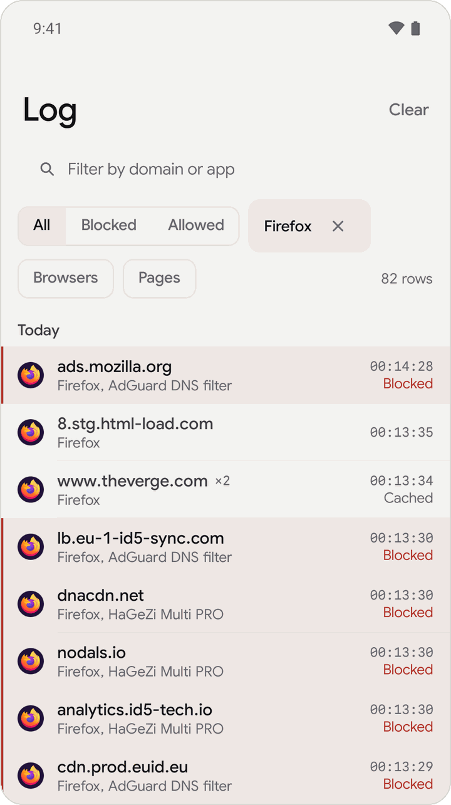

# Aduster

Aduster is a free ad and tracker blocker for Android. It blocks ad and tracker domains in every
app, and in Chromium browsers it also cleans up the pages themselves. Everything runs on the
phone: no account, no root, no Aduster server.

Download the APK from the [latest release](https://github.com/TheWrathRF/aduster/releases/latest),
or add Aduster to
[Obtainium](https://apps.obtainium.imranr.dev/redirect?r=obtainium://app/%7B%22id%22%3A%22app.aduster%22%2C%22url%22%3A%22https%3A%2F%2Fgithub.com%2FTheWrathRF%2Faduster%22%2C%22author%22%3A%22TheWrathRF%22%2C%22name%22%3A%22Aduster%22%7D)
to get each new version. Earlier versions are on the [releases](https://github.com/TheWrathRF/aduster/releases) page.
Android 13 or later, on a 64-bit ARM phone.

[](https://github.com/TheWrathRF/aduster/actions/workflows/ci.yml)

<p align="center">
  <picture>
    <source media="(prefers-color-scheme: dark)" srcset=".github/media/page-dark.png">
    
  </picture>
</p>

The same recipe page, loaded on the same phone. On the left, with DNS filtering only: the ad
servers are blocked, but the page still shows its consent window and an empty ad strip. On the
right, with Aduster's page filtering on.

## How it differs

| | Blocks in every app | Cleans up pages |
|---|---|---|
| Aduster | Yes | In Chromium browsers |
| DNS blockers | Yes | No |
| Browser blockers | No | In one browser |

DNS blockers are apps such as RethinkDNS and personalDNSfilter, or a blocking DNS server set in
Android's Private DNS. Browser blockers are uBlock Origin in Firefox and Brave's own blocking.
From each project's own pages, November 2026.

## What it blocks

| Blocked | Left alone |
|---|---|
| Ad and tracker servers, in every app | Banking and payment sites |
| Trackers hidden behind a site's own domain | Sign-in, government and CAPTCHA pages |
| Ads and cookie notices inside web pages | Devices on your local network |
| Apps that try to bypass the filter with their own DNS | Apps and sites you choose to exclude |

To see it for yourself, open a public ad block test such as
[adblock.turtlecute.org](https://adblock.turtlecute.org/) on your phone with Aduster on.

## Every app

Every app's DNS lookups go through Aduster's DNS engine on the phone. A domain on a blocklist
gets `0.0.0.0` (or `::`) as its answer at once, so the app never connects to it; the rest go to
the DNS server you choose, over plain DNS, DNS over HTTPS or DNS over TLS. Trackers hidden behind
a site's own domain (CNAME cloaking) are caught too, and with Block DNS bypass on, apps cannot
get around the filter with their own encrypted DNS.

The Log shows each lookup and each request blocked in a page as it happens, with the app that
made it. Tap a row there to allow or block that domain. Apps that should not be filtered at all
can be left out in Settings › Excluded apps.

<p align="center">
  <picture>
    <source media="(prefers-color-scheme: dark)" srcset=".github/media/log-dark.png">
    
  </picture>
</p>

## In the browser

With Aduster's certificate installed, Chromium browsers have their pages filtered as well, and
so do links that other apps open inside them (Custom Tabs). Requests on AdGuard's and uBlock
Origin's lists are blocked, cookie notices are dismissed, and empty ad boxes are hidden before
the page paints. What a page needed hidden is remembered for that site, so the next visit is
clean from the start, and on a site where a fix misbehaves, Aduster backs off by itself.

Banks, payments, sign-in, government and CAPTCHA pages, local addresses and Firefox are never
decrypted. A site with a bad certificate shows the browser's own warning.

## How it works

Aduster uses Android's VPN for DNS only: Android sends lookups to an address inside the tunnel,
and nothing else is routed into it, so apps' own traffic goes straight to the network as before.
For web pages, it also sets a proxy on the phone (`127.0.0.1`). Browsers that trust Aduster's
certificate are filtered there, with every site's certificate checked against the Chrome Root
Store; anything else that reaches the proxy is passed on untouched, and a browser that rejects
the certificate keeps DNS filtering only.

## Source and trust

The source of the app is published here so anyone can read how traffic is routed and filtered,
but it is not open source: see [`LICENSE`](LICENSE). The release APKs are free to install and
use. The lists and libraries Aduster uses keep their own licences, listed in
[`THIRD_PARTY_NOTICES.md`](THIRD_PARTY_NOTICES.md) and in the app under Settings › About ›
Open-source licences.

This repository holds the app (Kotlin and Jetpack Compose), the DNS engine, the rule matcher and
the bridge between them (Rust, in `core/crates/`). The page engine, which filters pages in
browsers, is private; it is Rust as well and runs inside the app. Here `core/crates/proxy` is a
stub with the same API, so a build of this repository alone is a complete DNS blocker without
page filtering. The release APK is built from this repository plus the private engine.

There is no Aduster server. Besides the sites you visit, the phone contacts only the filter list
hosts and the DNS server you picked. The certificate for page filtering is made on your phone
when you set it up, and its private key never leaves the app.

## Measured overhead

Measured on one test phone in October 2026, loading the same eight web pages without and with
Aduster; other phones, versions and lists will differ.

| Measured | Without Aduster | With Aduster |
|---|---|---|
| Browser CPU time loading the pages | 128.8 s | 53.6 s |
| Browser CPU time in the background | 4.9 s | 0.9 s |

With filtering always on, Aduster's share of the phone's battery use was 0.36%, and it used
0.2 s of CPU time per five idle minutes. It sets no wake-up alarms and holds no wakelocks, so it
never wakes a sleeping phone; list updates run as one daily system job.

## Install

1. Download the APK from the [latest release](https://github.com/TheWrathRF/aduster/releases/latest)
   and open it on the phone. Allow installing from your browser or file manager when asked. If
   Play Protect warns about an app that is not from the Play Store, choose Install anyway.
2. Open Aduster and tap Turn on. Android asks to allow a VPN connection: Aduster uses Android's
   VPN to filter lookups on the phone; it is not a VPN to a server.
3. For page filtering, open Settings › Page filtering and follow its three steps: save the
   certificate, install it in Android's settings, turn it on.

Two Android settings get in the way. If Private DNS (search Android's Settings for "Private
DNS") is set to a provider's hostname, Android sends its lookups around Aduster: set it to
Automatic or Off. And leave Block connections without VPN off for Aduster: since its tunnel
carries only DNS, that setting would cut every app off from everything but DNS. Aduster's Home
screen warns about both.

To have filtering start with the phone, search Android's Settings for "VPN", tap the gear next
to Aduster and turn on Always-on VPN. Aduster has no update check of its own; Obtainium (linked
at the top) can watch this repository's releases for you.

<details>
<summary>Check the download</summary>

Compare the APK's SHA-256 with the `.sha256` file next to it on the release page, using the
file name you downloaded:

```sh
sha256sum aduster-X.Y.Z.apk                  # Linux
shasum -a 256 aduster-X.Y.Z.apk              # macOS
certutil -hashfile aduster-X.Y.Z.apk SHA256  # Windows
```

</details>

<details>
<summary>Uninstall</summary>

Uninstall the app as usual. The certificate stays in Android until you remove it: search
Settings for "User credentials", tap the Aduster certificate and Remove. Without the app it is
harmless (its private key was inside the app and is gone), but there is no reason to keep it.

</details>

## Known limitations

- Firefox has its ads and trackers blocked by DNS, but its pages are not filtered: page
  filtering is for Chromium browsers, by design.
- Page filtering is tested in Google's browser and in Brave. Edge, Samsung Internet, Opera,
  Vivaldi and other Chromium browsers are expected to work but are not tested; a browser that
  refuses the certificate falls back to DNS filtering by itself.
- IPv6 works on dual-stack networks. IPv6-only networks (NAT64, 464XLAT) are handled in code
  and tests but not yet verified on a real network.
- DNS answers larger than the size a client asked for are passed on whole instead of being
  truncated, and a client that retries such a lookup over TCP has its connection reset. Ordinary
  lookups are far below the limit.
- Android runs one VPN app at a time, so Aduster cannot run alongside another VPN.
- Over plain HTTP (not HTTPS), a public page can still reach a device on your local network,
  such as your router's admin page, by showing it in a frame. Aduster cannot tell such a frame
  from a link you clicked, and blocking both would break links to your router from other pages.

## Build the public part

The public build is the app with the DNS engine; page filtering is not part of it.

<details>
<summary>Requirements and commands</summary>

You need JDK 17, the Android SDK (found through `ANDROID_HOME` or `local.properties`) with
platform 37 and NDK `30.0.16248370`, `rustup` (the Rust version, its components and the
Android target are pinned in `core/rust-toolchain.toml`), and `cargo-ndk`:

```sh
cargo install cargo-ndk
git clone https://github.com/TheWrathRF/aduster.git
cd aduster
(cd core && rustup toolchain install)
./gradlew :app:assembleDebug
```

The APK is `app/build/outputs/apk/debug/app-debug.apk`, signed with the standard debug key, so
it does not install over the release (uninstall that first). Tests and checks, from the
repository's root:

```sh
(cd core && cargo test --workspace && cargo clippy --workspace --all-targets -- -D warnings)
./gradlew :app:testDebugUnitTest :app:lintDebug
```

CI runs the Rust tests, clippy with warnings as errors, the Kotlin tests, lint and a debug build
on every push. DNS lists are downloaded and compiled on the phone into a memory-mapped hash
table, which the engine only loads; the native library makes only `JNI_OnLoad` visible to the
app and is aligned for 16 KB memory pages.

</details>

## FAQ

<details>
<summary>Why a certificate?</summary>

To filter a page, Aduster has to read it, and an HTTPS page can only be read by something the
browser trusts. The certificate is made on your phone when you set it up, its key never leaves
the app, and it is used only for browsers. Without it, Aduster still filters by DNS.

</details>

<details>
<summary>What if a site breaks?</summary>

Open Filters › Custom and enter the site under Fix a site: it lists what Aduster did there and
offers the fix, such as Allow on this site or Never decrypt. You can also tap a blocked row in
the Log and allow it, or pause Aduster for a while from Home.

</details>

## Contact

Email arda@aduster.site. For security problems, see [`SECURITY.md`](SECURITY.md).

Copyright 2026 Arda Başal. All rights reserved.
