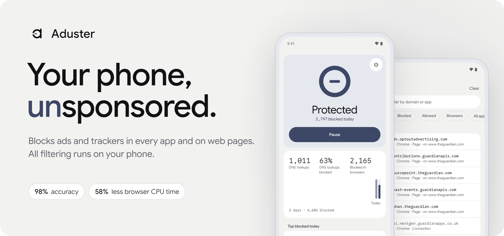
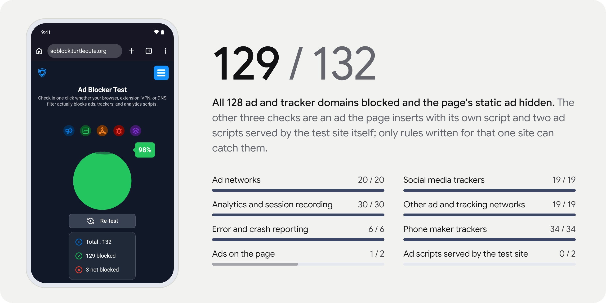
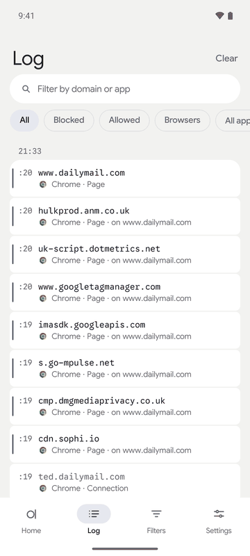
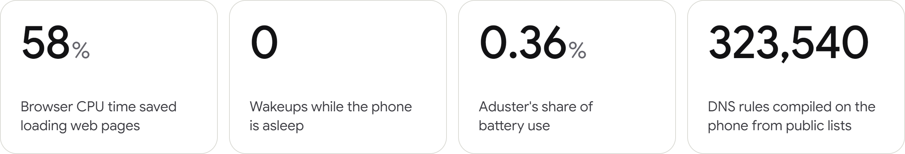
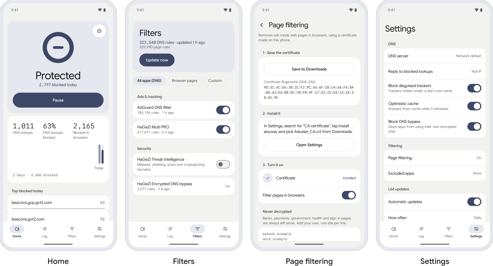

<p align="center">
  <picture>
    <source media="(prefers-color-scheme: dark)" srcset=".github/media/hero-dark.png">
    
  </picture>
</p>

<p align="center">
  <a href="https://github.com/TheWrathRF/aduster/releases/latest"><picture><source media="(prefers-color-scheme: dark)" srcset=".github/media/download-dark.png"></picture></a>&nbsp;
  <a href="https://apps.obtainium.imranr.dev/redirect?r=obtainium://app/%7B%22id%22%3A%22app.aduster%22%2C%22url%22%3A%22https%3A%2F%2Fgithub.com%2FTheWrathRF%2Faduster%22%2C%22author%22%3A%22TheWrathRF%22%2C%22name%22%3A%22Aduster%22%7D"><picture><source media="(prefers-color-scheme: dark)" srcset=".github/media/obtainium-dark.png"></picture></a>
</p>

<p align="center">
  <a href="#install">Install</a> ·
  <a href="#how-it-works">How it works</a> ·
  <a href="#build-the-public-part">Build</a> ·
  <a href="https://github.com/TheWrathRF/aduster/actions/workflows/ci.yml"></a>
</p>

Aduster blocks ads and trackers for every app on an Android phone, and in Chromium browsers it
also removes them from web pages before they appear. Everything runs on the phone: there is no
Aduster server or account, and no root is needed.

## The test

<picture>
  <source media="(prefers-color-scheme: dark)" srcset=".github/media/test-dark.png">
  
</picture>

This is [adblock.turtlecute.org](https://adblock.turtlecute.org/), a public ad block test, run
on 29 October 2026 in a Chromium browser on an Android 16 emulator with Aduster's default lists.
With page filtering off, the same test scores 128 of 132: every domain is still blocked by DNS,
and the four checks inside the page fail. Open the test on your phone with Aduster on to see
your own result.

## Every app

<picture>
  <source media="(prefers-color-scheme: dark)" srcset=".github/media/log-dark.gif">
  
</picture>

Every app's DNS lookups go through Aduster's DNS engine on the phone. A domain on a blocklist
gets `0.0.0.0` (or `::`) as its answer at once, so the app never connects to it; the rest go to
the DNS server you choose, over plain DNS, DNS over HTTPS or DNS over TLS. Trackers hidden behind
a site's own domain (CNAME cloaking) are caught too, and with Block DNS bypass on, apps cannot
get around the filter with their own encrypted DNS.

The Log shows each lookup and each blocked page request as it happens, with the app that made
it. Tap a domain there to allow or block it.

Apps that should not be filtered at all can be left out in Settings › Excluded apps.

## In the browser

With Aduster's certificate installed, Chromium browsers get their pages filtered as well:
requests blocked by AdGuard's and uBlock Origin's lists, the empty ad slots hidden, cookie
notices dismissed. A small model on the phone also scores what looks or acts like an ad that no
list knows yet; what it removes becomes a rule, so next time it never loads.

Banks, payments, sign-in, government and CAPTCHA pages, local addresses and Firefox are never
decrypted. A site with a bad certificate shows the browser's own warning.

## How it works

<picture>
  <source media="(prefers-color-scheme: dark)" srcset=".github/media/flow-dark.svg">
  
</picture>

Aduster uses Android's VPN for DNS only: Android sends lookups to an address inside the tunnel,
and nothing else is routed into it. For web pages, it also sets a proxy on the phone
(`127.0.0.1`). Browsers that trust Aduster's certificate are filtered there, with every site's
certificate checked against the Chrome Root Store; anything else that reaches the proxy is passed
on untouched, and a browser that rejects the certificate keeps DNS filtering only.

There is no Aduster server. Besides the sites you visit, the phone contacts only the filter list
hosts and the DNS server you picked.

## Numbers

<picture>
  <source media="(prefers-color-scheme: dark)" srcset=".github/media/numbers-dark.png">
  
</picture>

Measured on one test phone in October 2026; other phones and lists will differ. Loading the same
eight pages took the browser 128.8&nbsp;s of CPU time without Aduster and 53.6&nbsp;s with it,
and its background CPU time fell from 4.9&nbsp;s to 0.9&nbsp;s. With filtering always on,
Aduster's share of the phone's battery use was 0.36% and it used 0.2&nbsp;s of CPU time per five
idle minutes; it sets no
timers, alarms or wakelocks, so it never wakes a sleeping phone. The rule count is that of the default
lists on 29 October 2026.

## Screens

<picture>
  <source media="(prefers-color-scheme: dark)" srcset=".github/media/screens-dark.png">
  
</picture>

## Install

Android 13 or later, on a 64-bit ARM (arm64) phone.

1. Download `aduster-1.0.0.apk` from the [latest release](https://github.com/TheWrathRF/aduster/releases/latest)
   and open it on the phone. Allow installing from your browser or file manager when asked. If
   Play Protect warns about an app that is not from the Play Store, choose **Install anyway**.
2. Open Aduster and tap **Turn on**. Android asks to allow a VPN connection: Aduster uses
   Android's VPN to filter lookups on the phone; it is not a VPN to a server.
3. For page filtering, open **Settings › Page filtering** and follow its three steps: save the
   certificate, install it in Android's settings, turn it on.

To have filtering start with the phone, search Android's Settings for "VPN", tap the gear next
to Aduster and turn on **Always-on VPN**. To get new versions when they come out, add Aduster to
[Obtainium](https://github.com/ImranR98/Obtainium), an open-source app that installs and updates
apps from their GitHub releases, with the button at the top of this page.

<details>
<summary>Check the download</summary>

Compare the APK's SHA-256 with the `.sha256` file next to it on the release page:

```sh
sha256sum aduster-1.0.0.apk                  # Linux
shasum -a 256 aduster-1.0.0.apk              # macOS
certutil -hashfile aduster-1.0.0.apk SHA256  # Windows
```

</details>

<details>
<summary>Uninstall</summary>

Uninstall the app as usual. The certificate stays in Android until you remove it: search
Settings for "User credentials", tap the Aduster certificate and **Remove**. Without the app it
is harmless (its private key was inside the app and is gone), but there is no reason to keep it.

</details>

## How it is built

- The app is Kotlin with Jetpack Compose. The DNS engine, the rule matcher and the bridge to the
  app are Rust, in `core/crates/`.
- DNS lists are downloaded and compiled on the phone into a memory-mapped hash table; the engine
  only loads the compiled file. The default lists came to 323,540 DNS rules on 29 October 2026.
- The native library makes only `JNI_OnLoad` visible to the app and is aligned for 16 KB memory
  pages.
- The page engine (the local proxy, page filtering and the on-device model) is private. It is
  Rust as well and runs inside the app, with no server in between; `core/crates/proxy` here is
  a stub with the same API. The release APK is built from this repository plus the private
  engine; a build from this repository alone is a complete DNS blocker and says page filtering
  is not part of it.
- CI runs the Rust tests, clippy with warnings as errors, the Kotlin tests, lint and a debug
  build on every push.

## Build the public part

The public build is the app with the DNS engine; page filtering is not part of it.

<details>
<summary>Requirements and commands</summary>

You need JDK 17, the Android SDK (found through `ANDROID_HOME` or `local.properties`) with
platform 37 and NDK `30.0.16248370`, `rustup` (the Rust version, its components and the
Android target are pinned in `core/rust-toolchain.toml`), and `cargo-ndk`:

```sh
cargo install cargo-ndk
git clone https://github.com/TheWrathRF/aduster.git
cd aduster
(cd core && rustup toolchain install)
./gradlew :app:assembleDebug
```

The APK is `app/build/outputs/apk/debug/app-debug.apk`, signed with the standard debug key, so
it does not install over the release (uninstall that first). Tests and checks, from the
repository's root:

```sh
(cd core && cargo test --workspace && cargo clippy --workspace --all-targets -- -D warnings)
./gradlew :app:testDebugUnitTest :app:lintDebug
```

</details>

## Known limitations

- Firefox has its ads and trackers blocked by DNS, but its pages are not filtered: page
  filtering is for Chromium browsers, by design.
- Page filtering is verified in Chrome and Brave. Edge, Samsung Internet, Opera, Vivaldi and
  other Chromium browsers are expected to work but are not verified; a browser that refuses the
  certificate falls back to DNS filtering by itself.
- IPv6 works on dual-stack networks. IPv6-only networks (NAT64, 464XLAT) are handled in code
  and tests but not yet verified on a real network.
- DNS answers larger than the size a client asked for are passed on whole instead of being
  truncated, and a client that retries such a lookup over TCP has its connection reset. Ordinary
  lookups are far below the limit.
- Android runs one VPN app at a time, so Aduster cannot run alongside another VPN.

## FAQ

<details>
<summary><b>Why a certificate?</b></summary>

To filter a page, Aduster has to read it, and an HTTPS page can only be read by something the
browser trusts. The certificate is made on your phone when you set it up, its key never leaves
the app, and it is used only for browsers. Without it, Aduster still filters by DNS.

</details>

<details>
<summary><b>What if a site breaks?</b></summary>

Tap its domain in the Log and allow it, or add the site to **Never decrypted** in Settings ›
Page filtering.

</details>

<details>
<summary><b>Is it open source?</b></summary>

The source is published to read; it is not under an open-source licence (see
[`LICENSE`](LICENSE)). The lists and libraries it uses keep their own licences: see
[`THIRD_PARTY_NOTICES.md`](THIRD_PARTY_NOTICES.md), also in the app under Settings › About ›
Open-source licences.

</details>

## Contact

arda@aduster.site · security problems: see
[`SECURITY.md`](SECURITY.md)

Copyright 2026 Arda Başal. All rights reserved.
